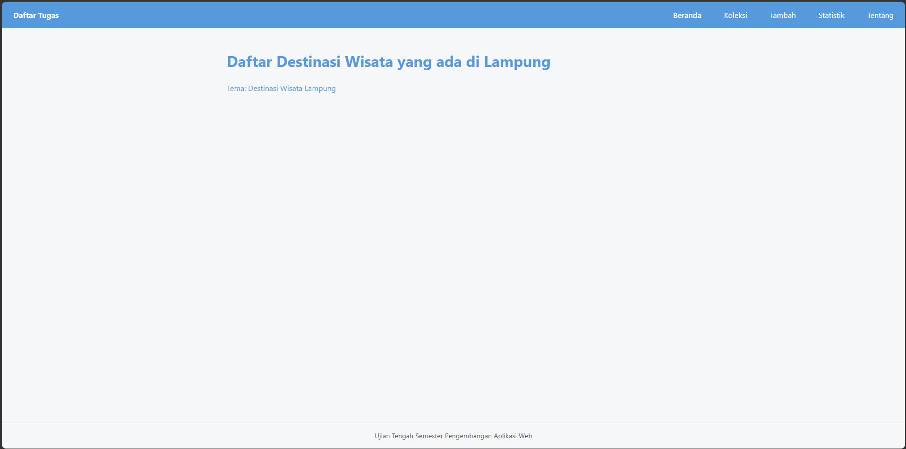
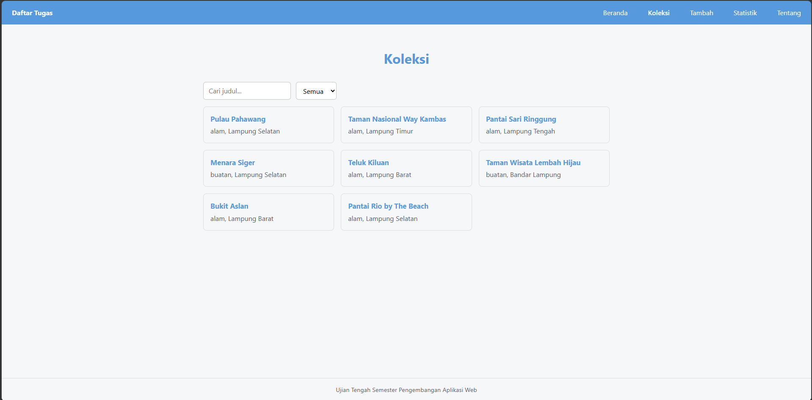
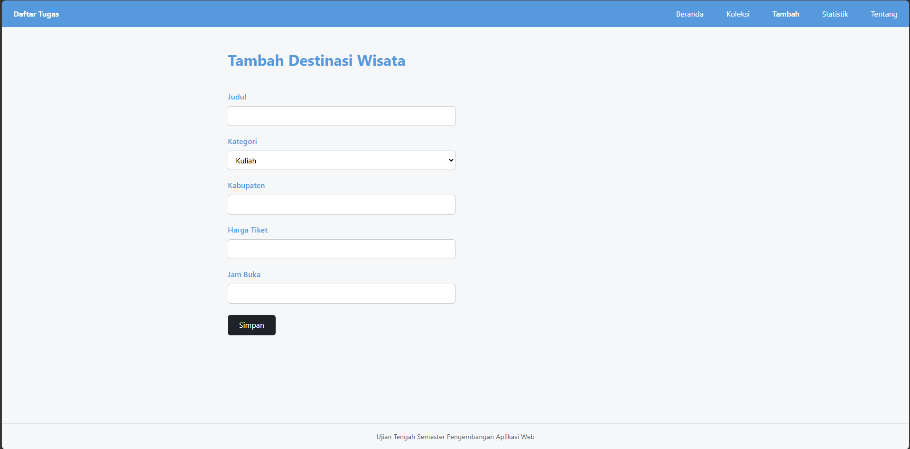
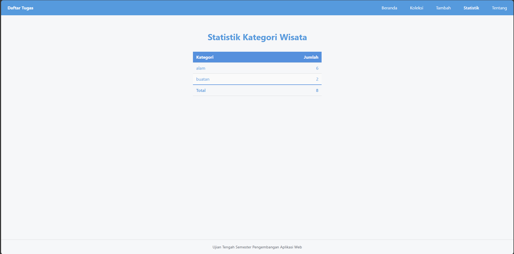
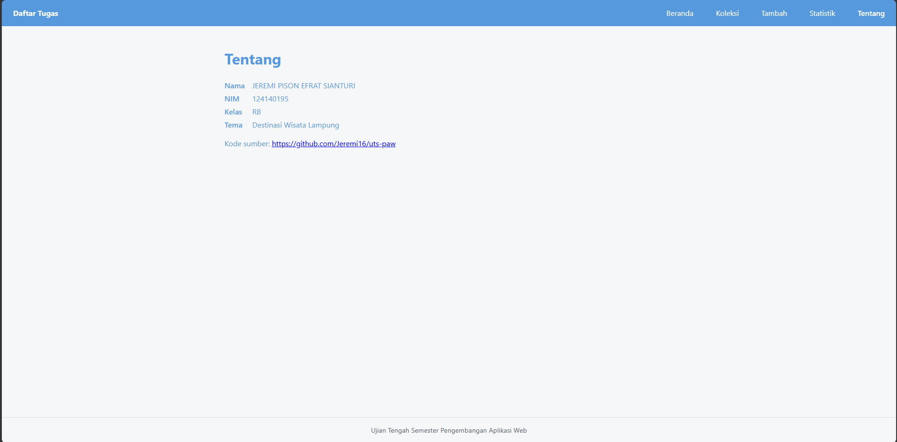

# Destinasi Wilayah yang ada di Lampung

Nama: JEREMI PISON EFRAT SIANTURI
NIM: 124140195
Kelas: RB
Tema: Destinasi Wisata Lampung
Deployment: https://jeremi16.github.io/uts-paw/

Beranda


Koleksi


Tambah


Statistik


Tentang


## Fitur

- menampilkan koleksi destinasi wisata di lampung
- menambahkan destinasi wisata di lampung 
- menampilkan statistik wisata di lampung berdasarkan kategori

## Menjalankan secara lokal

cd app
npm install
npm run dev

## Konsep React yang dipakai

- components, yaitu saya menbuat kompenen biar bisa dipakai lagi
- props, yaitu ketika mau kirim data dari suatu komponen ke komponen lain
- fragments, ini kalau di return mau lebih dari satu yg direturn
```
